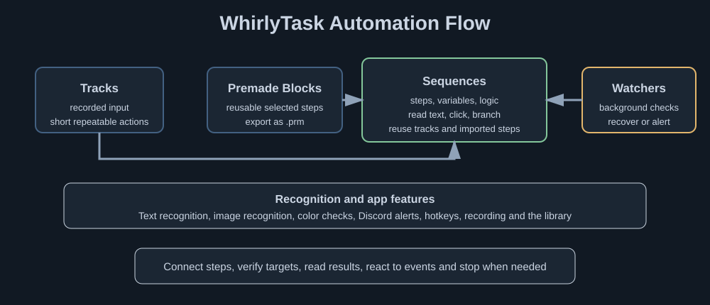

# WhirlyTask

Build Windows desktop automations with recorded input, connected steps, screen recognition and background watchers.

Use the graph editor to connect actions, compare variables, recognize screen targets and save reusable Premade Blocks.

## Build your first workflow

1. Open [Getting Started](docs/Getting-Started.md).
2. Connect a small sequence from **Start** to the actions you need.
3. Select a step to edit its settings on the right. With no selection, the canvas uses that space.
4. Test with a [Status Message](docs/Steps/Status-Message.md), then use **Save** to keep your work.

Use **Ctrl+S** to save, **Ctrl+Shift+S** to save under another name, and **Ctrl+O** to open a file. The editor also recovers its working session across a normal restart. See [Editors and saving](docs/App-Features/Editors-And-Saving.md).

## Choose the right building block

| You need | Use |
| --- | --- |
| Replay a recorded mouse/keyboard action | [Track](docs/Basics/Track.md) |
| Decisions, waits, variables and connected actions | [Sequence](docs/Basics/Sequence.md) |
| Reuse selected steps in another workflow | [Premade Block](docs/Basics/Premade-Blocks.md) |
| React to an event while the sequence runs | [Watcher](docs/Watchers/README.md) |
| Store screen text, counters or other results | [Variables](docs/Values/README.md) |

## Recognize what is on screen

| Target | Start here |
| --- | --- |
| A word, number or sentence | [Text recognition](docs/Recognition/Text.md) |
| An image with some visual variation | [Smart image recognition](docs/Recognition/Images.md) |
| A literal image at its original size | [Pixel image recognition](docs/Recognition/Pixel.md) |
| Any pixel of a chosen color inside an area | [If Pixel](docs/Steps/If-Pixel.md) |
| An image that should be clicked only when found | [If Image Click](docs/Steps/If-Image-Click.md) |

Text recognition runs locally. The OCR search steps have character filters, while **Read Text** writes filtered output to a variable. Recognition can fail on hidden, ambiguous or unreadable targets; a failed scan is not proof that a target is absent.

## Find a page

| Topic | What you will find |
| --- | --- |
| [Documentation index](docs/README.md) | All sections and quick routes |
| [Graph editor](docs/App-Features/Graph-Editor.md) | Selection, connections, IDs, Auto Layout and reusable blocks |
| [Step reference](docs/Steps/README.md) | Current step names, fields and behavior |
| [Variables](docs/Values/README.md) | Starter values, Text/Math, references and Reset Variable |
| [Watchers](docs/Watchers/README.md) | Triggers, intervals, cooldowns and control flow |
| [Guides](docs/Guides/README.md) | Complete workflow walkthroughs |
| [Examples](docs/Examples/README.md) | Small patterns you can adapt |
| [App features](docs/App-Features/README.md) | Library, recording, hotkeys, appearance and protections |
| [Troubleshooting](docs/Troubleshooting/README.md) | Checks organized by the problem you see |
| [Tips](docs/Tips/README.md) | Practical ways to keep workflows readable and reliable |

Use the exact field names shown in your app. This repository documents behavior, not a guarantee that every screen or application can be automated successfully.

## Maintaining the documentation

Run `python tools/check_docs.py` before submitting an update. It checks local links, heading anchors, path casing and SVG files without downloading anything. Follow [the screenshot guide](docs/assets/screenshots/README.md) when adding images.
