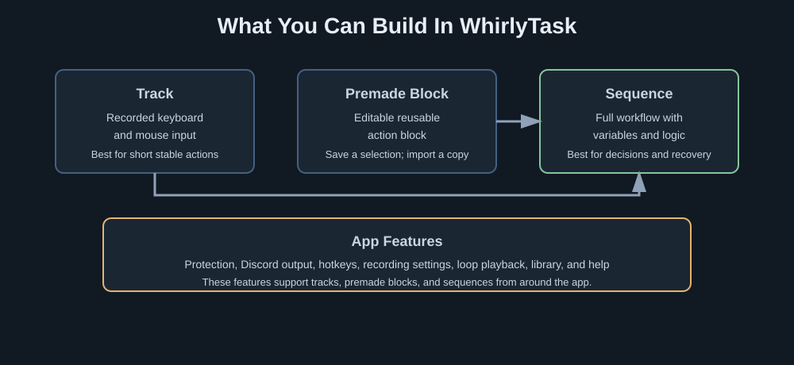

# Basics

WhirlyTask combines recorded input with an editable graph of actions, decisions, variables, and background watchers.

| Item | Use it for | Learn more |
| --- | --- | --- |
| Track | Replay recorded mouse and keyboard input | [Track](Track.md) |
| Sequence | Build the main workflow and decide what happens next | [Sequence](Sequence.md) |
| Premade Block | Save selected graph nodes for reuse in another workflow | [Premade Blocks](Premade-Blocks.md) |

Start with a short Track for a fixed recording, or a Sequence when the next action depends on the screen or a variable. Create Premade Blocks from useful selections once the workflow works.

## Inside A Sequence

A Sequence can contain several named blocks, Starter Variables, and Watchers. Connections determine execution order. An If step has separate Then and Else paths; a Watcher has its own action chain beside the main flow.

| Need | Where to look |
| --- | --- |
| Choose an item type | [Choosing What To Use](Choosing-What-To-Use.md) |
| Understand variable names and values | [Variables](../Values/README.md) |
| React to unexpected events | [Watchers](../Watchers/README.md) |
| Understand saving and recovery | [Editors And Saving](../App-Features/Editors-And-Saving.md) |
| Compare text, image, and pixel checks | [Recognition](../Recognition/README.md) |
