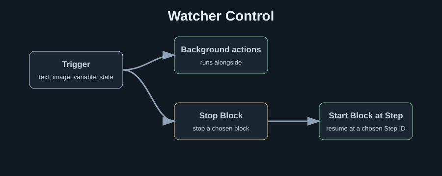

# Watchers

A Watcher checks a condition while a Sequence is running and starts its own action chain when that condition is valid. Use one for a side event that may happen at an unexpected time. Use a normal If or Wait For step for the next expected part of the main path.

## Add A Watcher

1. Open the Sequence graph editor and select the **Watcher** toolbox tab.
2. Add a trigger card such as **Text Watcher** or **Image Watcher**.
3. Select the trigger to configure its condition and shared run settings.
4. Add ordinary actions from **All**, **Basic**, or **Variable** and connect them to the Watcher chain.
5. Use **Save Draft**, then test while the main flow remains running.

The Watcher tab contains trigger cards. Its action chains use the same ordinary steps as the main graph. **Variable Watcher** also appears in the Variable tab.

## Choose A Trigger

| Trigger | Checks |
| --- | --- |
| [Text Watcher](Triggers/When-Text.md) | Recognized text in a screen area |
| [Image Watcher](Triggers/When-Image.md) | A Smart or Pixel image target |
| [Window Watcher](Triggers/When-Window.md) | A window's open, focus, or fullscreen state |
| [Variable Watcher](Triggers/When-Sequence-Value.md) | A variable's value, existence, or change |
| [Time Watcher](Triggers/When-Time.md) | A daily clock time and time zone |
| [Timer Watcher](Triggers/When-Timer.md) | Elapsed time since playback or a previous trigger |
| [Chance Watcher](Triggers/For-Chance.md) | Repeated probability rolls |
| [Internet Watcher](Triggers/When-Internet.md) | Online or offline state |

## Main Steps Keep Running

Triggering a Watcher does not automatically pause the main flow. A notification can run alongside the main actions. If recovery must stop a main block, use **Stop Block** explicitly and design how that block will start again.

The **If another watcher is already running** option controls conflicts between Watchers. It does not stop the main flow.

A failed capture or unavailable recognition engine is not confirmed absence. An `is not seen` Watcher must not be used as an error handler for OCR or image-engine failures.

## Repetition And End Of Playback

A condition that stays true can fire again after its cooldown. Make recovery remove the condition, or choose a cooldown that suits the task. A Timer Watcher in after mode is a one-shot elapsed-time trigger; every mode repeats.

Watchers belong to playback. If the Sequence finishes or stops, they do not remain as independent background automations. Keep the main path alive while testing a Watcher.

See [Watcher Settings](Watcher-Settings.md), [Controlling Main Blocks](Steps/Pause-Sequence.md), [Examples](Examples.md), and [Troubleshooting](Troubleshooting.md).
